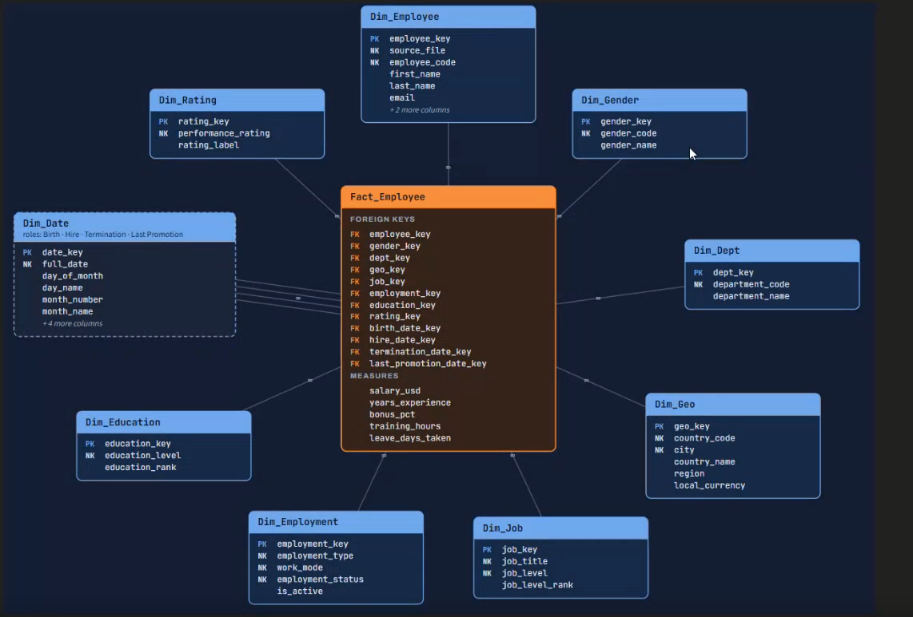

# Employee Data Warehouse (SSIS)

An end-to-end ETL project built with **SQL Server Integration Services (SSIS)** that loads employee/HR data through three layers into a star-schema data warehouse.

## Architecture

```
Source files  ->  ODS  ->  STG  ->  DWH (star schema)
```

| Layer | Purpose |
|-------|---------|
| **ODS** | Raw copy of the source data, loaded as-is |
| **STG** | Cleaned and standardized data (types, nulls, duplicates, business rules) |
| **DWH** | Dimensional model: one fact table and conformed dimensions |

## Data Model (Star Schema)

**Fact table:** `Fact_Employee`
- Measures: `salary_usd`, `years_experience`, `bonus_pct`, `training_hours`, `leave_days_taken`

**Dimensions:**
- `Dim_Employee`
- `Dim_Gender`
- `Dim_Dept`
- `Dim_Geo`
- `Dim_Job`
- `Dim_Employment`
- `Dim_Education`
- `Dim_Rating`
- `Dim_Date` (role-playing: Birth, Hire, Termination, Last Promotion)



## Repository Structure

```
.
├── SSIS/                 # SSIS solution (.sln, .dtproj, .dtsx, .conmgr, .params)
├── SQL/
│   ├── 01_ODS/           # ODS table scripts
│   ├── 02_STG/           # STG table scripts
│   └── 03_DWH/           # Dimension and fact table scripts
├── data/sample/          # Small sample of the source data
├── docs/                 # Data model image and documentation
└── README.md
```

## How to Run
> **Note:** The project loads data from CSV, Excel and XML sources. Only a 50-row CSV sample is included in `data/sample/`. Update the source paths in the SSIS connection managers to point to your own files.
1. Create the databases (or schemas) for ODS, STG and DWH using the scripts in `SQL/`.
2. Open the solution in **Visual Studio** with the *SQL Server Integration Services Projects* extension.
3. Update the connection managers (server name, database names, source file path).
4. Run the packages in this order: ODS -> STG -> DWH (dimensions first, then the fact table).

## Tools

- SQL Server
- SSIS (Visual Studio)
- T-SQL
