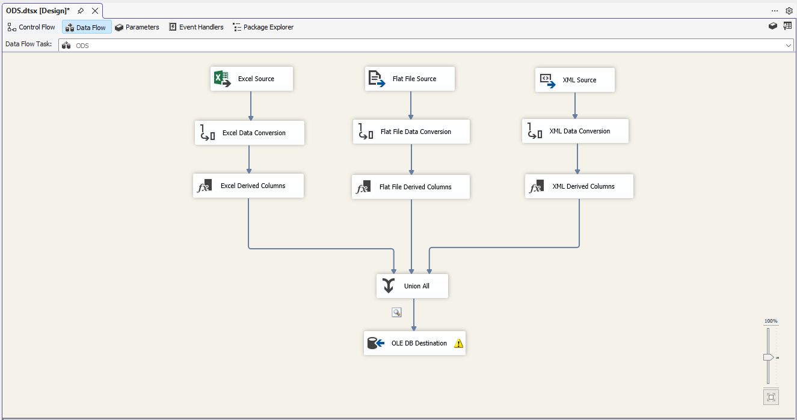
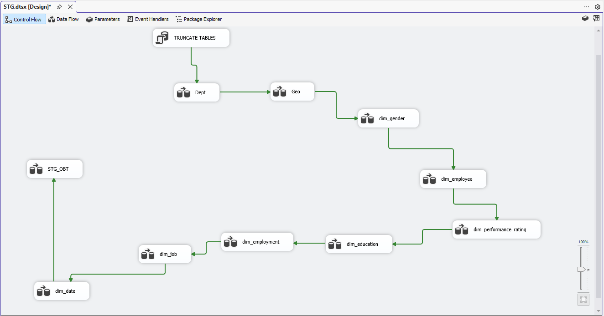
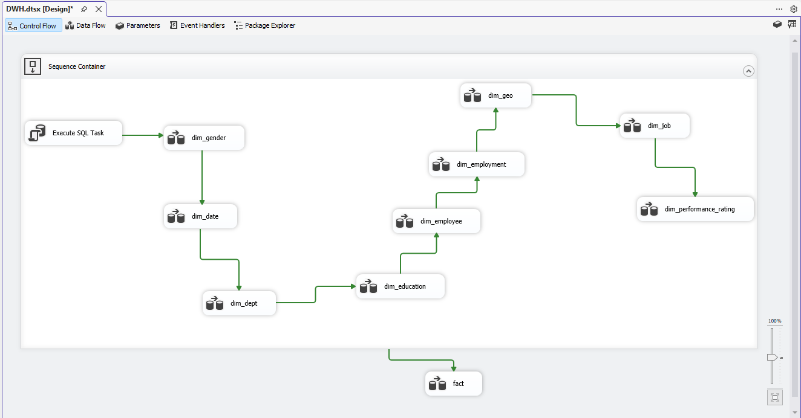

# Employee Data Warehouse (SSIS)

An end-to-end ETL project built with **SQL Server Integration Services (SSIS)**. It ingests employee/HR data from three different source formats (Excel, CSV and XML), moves it through three layers, and loads it into a star-schema data warehouse on SQL Server.

## Architecture

```
Excel  ┐
CSV    ├─>  HR_ODS  ->  HR_STG  ->  HR_DWH (star schema)
XML    ┘
```

| Layer | Database | SSIS package | Purpose |
|-------|----------|--------------|---------|
| **ODS** | `HR_ODS` | `ODS.dtsx` | Raw landing area. Reads the three sources, converts data types, adds derived columns and unions everything into one table |
| **STG** | `HR_STG` | `STG.dtsx` | Staging area. Truncates the tables, then builds one staging table per dimension plus a consolidated table (`STG_OBT`) |
| **DWH** | `HR_DWH` | `DWH.dtsx` | Final dimensional model. Loads all dimensions first, then the fact table |

## Data Model (Star Schema)

**Fact table:** `Fact_Employee`
- Measures: `salary_usd`, `years_experience`, `bonus_pct`, `training_hours`, `leave_days_taken`

**Dimensions:**
- `Dim_Employee`
- `Dim_Gender`
- `Dim_Dept`
- `Dim_Geo`
- `Dim_Job`
- `Dim_Employment`
- `Dim_Education`
- `Dim_Rating`
- `Dim_Date` (role-playing: Birth, Hire, Termination, Last Promotion)


## ETL Packages

### 1. ODS: `ODS.dtsx`

The data flow reads from three different source types in parallel. Each source goes through its own **Data Conversion** and **Derived Columns** steps, then all three are merged with **Union All** and written to the ODS table through an OLE DB Destination.

| Source | Components |
|--------|------------|
| Excel | Excel Source -> Excel Data Conversion -> Excel Derived Columns |
| CSV | Flat File Source -> Flat File Data Conversion -> Flat File Derived Columns |
| XML | XML Source -> XML Data Conversion -> XML Derived Columns |



### 2. STG: `STG.dtsx`

The control flow first runs a **TRUNCATE TABLES** Execute SQL Task, so the package can be re-run safely. It then loads the staging tables one after another: `Dept`, `Geo`, `dim_gender`, `dim_employee`, `dim_performance_rating`, `dim_education`, `dim_employment`, `dim_job` and `dim_date`, and finally the consolidated `STG_OBT` table.



### 3. DWH: `DWH.dtsx`

The control flow starts with an **Execute SQL Task**, followed by a **Sequence Container** that loads the dimensions in order: `dim_gender`, `dim_date`, `dim_dept`, `dim_education`, `dim_employee`, `dim_employment`, `dim_geo`, `dim_job` and `dim_performance_rating`. Once every dimension is loaded, the `fact` table is loaded last, so all surrogate keys are available.



## Repository Structure

```
.
├── Employees_DWH.slnx        # Visual Studio solution
├── Employees_DWH/            # SSIS project
│   ├── ODS.dtsx
│   ├── STG.dtsx
│   ├── DWH.dtsx
│   ├── Project.params
│   └── Employees_DWH.dtproj
├── SQL/
│   ├── 00_create_databases.sql   # Drops and recreates HR_ODS, HR_STG, HR_DWH
│   ├── 01_ODS/                   # ODS table scripts
│   ├── 02_STG/                   # STG table scripts
│   └── 03_DWH/                   # Dimension and fact table scripts
├── data/sample/              # 50-row sample of the CSV source
├── docs/                     # Data model and package screenshots
└── README.md
```

## How to Run

1. Run the SQL scripts in this order:
   1. `SQL/00_create_databases.sql`
   2. `SQL/01_ODS/create_ods_tables.sql`
   3. `SQL/02_STG/create_stg_tables.sql`
   4. `SQL/03_DWH/create_dwh_tables.sql`

   > **Warning:** `00_create_databases.sql` drops `HR_ODS`, `HR_STG` and `HR_DWH` if they already exist. Use it on a development server only.
2. Open `Employees_DWH.slnx` in **Visual Studio** with the *SQL Server Integration Services Projects* extension (Visual Studio 2022 17.13 or later is needed for the `.slnx` format).
3. Update the connection managers (server name, database names, source file paths).
4. Run the packages in this order: `ODS.dtsx` -> `STG.dtsx` -> `DWH.dtsx`.

> **Note:** The project loads data from CSV, Excel and XML sources. Only a 50-row sample of the CSV is included in `data/sample/`. Point the source connections to your own files.

## Tools

- SQL Server
- SSIS (Visual Studio)
- T-SQL
